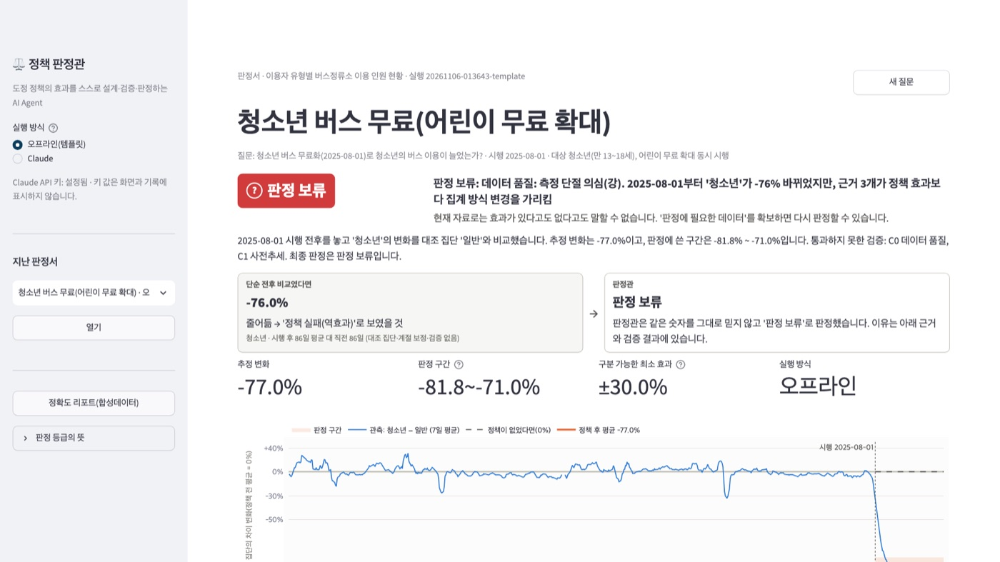
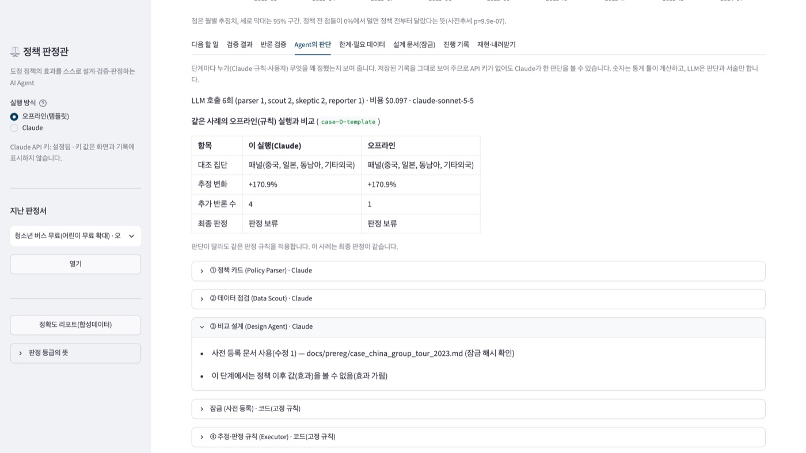
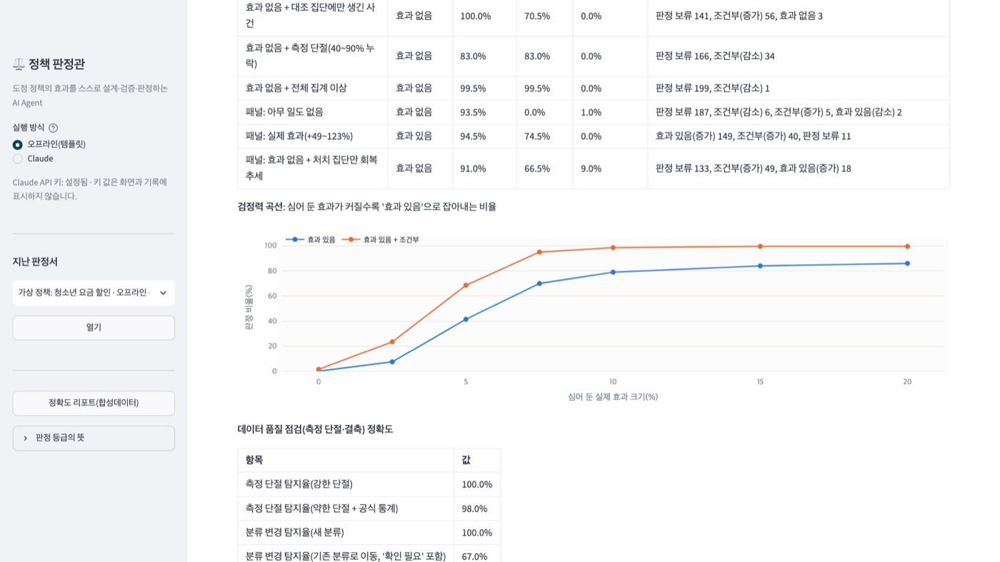

<div align="center">

# 정책 판정관 J-Verdict

**제주도 정책이 정말 효과가 있었는지, 스스로 분석을 설계 · 검증한 뒤 판정하는 인과추론 AI Agent**

2026 제주 AI·빅데이터 활용 AI Agent 개발 챌린지 출품작

[**웹 데모 바로가기**](https://jverdict.streamlit.app) <sub>(설치 없이 브라우저에서 실행 · 처음 열 때 30~60초 걸릴 수 있습니다)</sub>




</div>

<br>

## 한눈에 보기

| 항목 | 내용 |
|---|---|
| 기간 | 2026 (공모전 출품) |
| 형태 | 개인 참가 |
| 내 역할 | **기획 · 분석 설계 · 개발 · 검증 전 과정** |
| 데이터 | 제주데이터허브 공개 데이터 (버스 승차, 카드 소비 등) |
| 판정 등급 | **효과 있음 · 조건부 · 효과 없음 · 판정 보류** |

## 문제

정책 효과는 흔히 "시행 전후 숫자 비교"로 판단됩니다. 하지만 같은 시기의 계절 변화, 경기 흐름, 데이터 집계 방식 변경이 섞이면 전후 비교만으로는 정반대의 결론이 나올 수 있습니다.

## 해결

질문 하나를 받으면 Agent가 비교 대상을 고르고, **결과를 보기 전에 분석 방법을 잠근 뒤**, 데이터 품질을 먼저 점검하고 스스로 반론을 세워 검증합니다.
근거가 부족하면 억지로 결론을 내지 않고, 무엇이 있으면 판정할 수 있는지를 함께 알려 줍니다.

### 단순 전후 비교 vs 정책 판정관

| 정책 (제주데이터허브 공개 데이터) | 단순 전후 비교 | 정책 판정관 |
|---|---|---|
| 청소년 버스 무료 (2025-08) | 청소년 승차 −76% → "정책 실패" | **판정 보류**: 측정 단절 의심 (도 발표와 8.3배 차이) |
| 1차 긴급재난지원금 (2020-05) | 도민 소비 +5.1% → "효과 있음" | **판정 보류**: 검정력 부족 (구분 가능한 최소 효과 ±16%) |
| 중국 단체관광 재개 (2023-08) | 중국인 소비 +106% → "효과 있음" | **판정 보류**: 사전추세 위반 (정책 전부터 회복 추세) |
| 사회적 거리두기 해제 (2022-04) | 도민 주점 소비 +95% → "효과 확실" | **판정 보류**: 기준 기간에 영업 중단 달 포함 |
| 합성데이터 (정답 +22.1%) | 청소년 +35.5% | **효과 있음** +19.6%, 판정 구간이 정답 포함 |
| 합성데이터 2 (정책 효과 0 + 같은 시기 행사) | 청소년 +6.4% → "효과 있음" | **판정 보류**: Agent가 같은 시기 행사를 반론으로 세워 검증한 뒤 판정을 낮춤 |

## 어떻게 판정하나



| 단계 | 담당 | 하는 일 |
|---|---|---|
| ① 정책 카드 | Claude (Policy Parser) | 질문이나 보도자료를 정책 · 시행일 · 대상으로 정리 |
| ② 데이터 점검 | Claude (Data Scout) | 측정 단절 · 결측을 효과 추정보다 **먼저** 점검 |
| ③ 비교 설계 | Claude (Design Agent) | 정책 전 유사도로 대조 집단 선택 (효과 값은 보지 않음) |
| 잠금 | 코드 | 설계를 SHA-256으로 잠그고, 바꾸면 기록을 남김 |
| ④ 추정 · 판정 | 코드 (고정 규칙) | 모든 수치는 결정론적 통계 코드가 계산 |
| ⑤ 반론 검증 | Claude (Skeptic) | 가짜 시행일, 같은 시기 다른 사건 같은 반론으로 결론 재검증 |
| ⑥ 판정서 | Claude (Reporter) | 결재용 3줄 요약, 재판정 시점, 자료 요청 공문 초안 작성 |

## 판정 정확도



정답을 심어 둔 합성데이터로 인과 판정 2,400회를 시험했습니다.

| 지표 | 결과 |
|---|---|
| 실제 효과를 "효과 있음"으로 판정 | 83% (시계열) · 74.5% (패널) |
| 없는 효과를 "효과 있음"으로 판정 | 2.4% (시나리오별 최악 9.0%) |
| 판정 보류 | 37.6% |

실데이터에 정답을 심은 반합성 시험에서는 더 보수적으로 판정했습니다 (효과가 없을 때 "효과 있음" 0%). "조건부"는 효과가 없는데 방향을 말한 비율이 23.2%라서, 성과 근거로 단독 인용하지 않습니다.

## 설계 원칙

1. **숫자는 코드가, 말은 LLM이.** 모든 수치는 결정론적 코드가 계산하고, LLM은 판단과 서술만 합니다.
2. **결과를 보기 전에 잠근다.** 분석 설계는 효과를 보기 전에 잠그고, 바꾸면 기록이 남습니다.
3. **데이터부터 의심한다.** 측정 단절 · 결측 점검을 효과 추정보다 먼저 실행합니다.
4. **보류도 결과물이다.** 왜 결론을 낼 수 없는지와 무엇이 있으면 낼 수 있는지를 함께 냅니다.

API 키가 없어도 오프라인(규칙) 모드로 같은 판정 규칙과 수치를 재현할 수 있습니다.

## 기술 스택

| 구분 | 사용 기술 |
|---|---|
| Language | Python 3.14 |
| UI | Streamlit |
| AI | Claude API (역할별 Agent: Parser · Scout · Design · Skeptic · Reporter) |
| 분석 | 이중차분(DiD) · 단절 시계열(ITS) · 플라시보 검정 · 검정력 분석 (자체 인과 엔진) |
| 품질 | pytest 자동 시험 139개, 설계 잠금(SHA-256), 재실행 대조 |

<details>
<summary><b>설치 · 실행 방법</b></summary>

<br>

**Windows 설치 묶음**

1. `JVerdict_win64_*.zip`을 짧은 경로에 풉니다. (예: `C:\JVerdict`)
2. `점검.bat`으로 이 PC에서 동작하는지 1~3분 확인합니다.
3. `실행.bat`을 실행하면 브라우저에 화면이 열립니다. (`http://localhost:8501`)

인터넷, 별도 설치, 관리자 권한이 필요 없습니다. Claude를 쓰려면 `.env.example`을 `.env`로 복사해 API 키를 넣습니다. 자세한 내용은 [설치 · 실행 매뉴얼](docs/manual/설치_실행.md)에 있습니다.

**macOS · Linux 개발 환경**

```bash
python3.14 -m venv .venv && .venv/bin/pip install -e ".[dev]"
.venv/bin/python -m jverdict.ui              # 화면
.venv/bin/python -m jverdict.agent --case A  # 명령줄 판정 (사례 A~F)
.venv/bin/python -m pytest                   # 자동 시험
```

공개 웹 데모와 이 저장소에는 제주데이터허브 원자료를 싣지 않았습니다. 재배포 조건을 확인하지 못했기 때문입니다. 실데이터를 새로 판정하려면 [data/README.md](data/README.md)대로 허브에서 자료를 받으세요.

</details>

<details>
<summary><b>폴더 구성</b></summary>

<br>

| 폴더 | 내용 |
|---|---|
| `src/jverdict/` | `agent` (Agent · 정책 카드), `causal` (인과 엔진), `quality` (측정 단절 진단), `synth` (합성데이터), `ui` (화면), `report` (판정서), `doctor` (설치 점검) |
| `outputs/runs/` | 사례별 판정 기록과 재실행 대조 결과 |
| `outputs/accuracy/` | 합성데이터 정확도 리포트 |
| `docs/` | 기획서, 사전 등록 문서, 연구 기록, 매뉴얼, 데이터 품질 점검 보고 |
| `tests/` | 자동 시험 |

</details>

<br>

<div align="center">
<sub>제작 · 신재우 · <a href="https://13jvv.github.io/">포트폴리오</a></sub>
</div>
